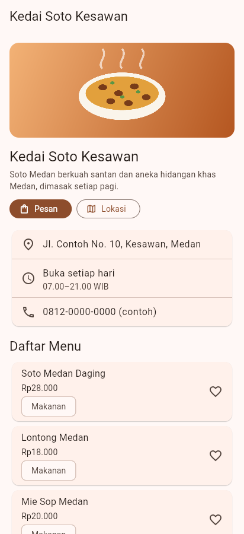
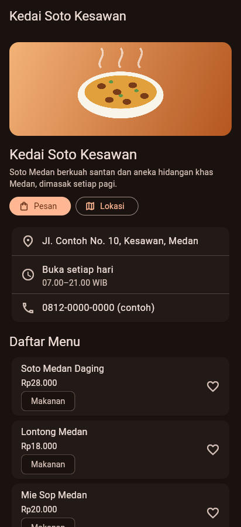
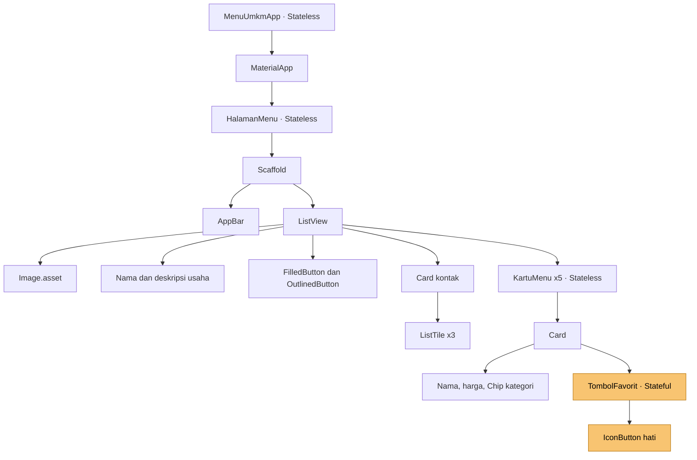

# Tugas Rutin 5 — Halaman Menu UMKM Kuliner Medan

Pemrograman Mobile (3KOM40215) · Pertemuan 5 · Ilmu Komputer UNIMED

Aplikasi satu halaman untuk **Kedai Soto Kesawan**, UMKM fiktif di Medan. Gambar kepala dibuat khusus untuk aplikasi ini.

## a. Identitas

| | |
|---|---|
| Nama  | Muhammad Tsabat Muhyiyuddin |
| NIM   | 4243250002 |
| Kelas | PSIK24D |
| GitHub | [tsabat15](https://github.com/tsabat15) |

## Cara menjalankan

```
flutter pub get
flutter run
flutter test
```

## b. Tangkapan layar

Diambil dari versi web di Chrome dengan lebar 412 px.

| Mode terang | Mode gelap |
|---|---|
|  |  |

## c. Diagram widget tree

Hanya `TombolFavorit` yang Stateful; bagian lain Stateless.



## d. Tiga pohon serta pilihan Stateless dan Stateful

Widget tree adalah konfigurasi yang saya tulis di `build()`, misalnya `Scaffold` berisi `ListView` dan `KartuMenu`. Objeknya immutable dan dibuat ulang setiap `build()` dipanggil, jadi harus ringan. Element tree adalah pasangan yang bertahan lama untuk setiap widget pada posisinya. Di sinilah objek `State` disimpan dan `BuildContext` berasal, sehingga status favorit tidak hilang saat widget dibuat ulang. Render tree berisi objek seperti `RenderFlex` dan `RenderParagraph` yang menghitung ukuran dan posisi, lalu menggambar ke layar.

`MenuUmkmApp`, `HalamanMenu`, dan `KartuMenu` saya buat Stateless karena tampilannya hanya bergantung pada parameter dan tema. Data menu tidak berubah saat aplikasi berjalan. `TombolFavorit` saya buat Stateful karena menyimpan satu data yang berubah akibat interaksi pengguna, yaitu status favorit. Bagian Stateful ini sengaja dibuat sekecil mungkin. Saat hati ditekan, `setState` hanya membangun ulang tombol tersebut, bukan seluruh halaman, sehingga kartu lain dan bagian kepala tidak ikut dibangun ulang. Karena tipe dan posisi widget baru cocok dengan yang lama, element dan render object lama dipakai kembali dan hanya ikonnya yang diperbarui. Inilah sebabnya pembangunan ulang tetap ringan.

## e. Pernyataan penggunaan AI

Saya menggunakan asisten AI untuk membantu menulis kode, membuat gambar kepala, mengambil tangkapan layar, dan menyusun README ini. Saya bertanggung jawab memahami seluruh isinya.
